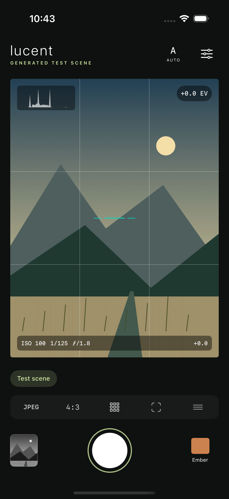

# Lucent

An independent, MIT-licensed camera for iPhone and iPad, built with SwiftUI,
AVFoundation, Core Image, Photos and Core Motion. iOS 18 or later.

Lucent aims to provide a free alternative to the publicly documented workflows
of professional manual camera apps. **Version 0.1 is not a 1:1 Halide clone.**
See [feature parity](docs/FEATURE_PARITY.md) for implemented features and gaps.
Original interface, color recipes and code. No accounts, payments, analytics,
third-party SDKs or network requests in the application.



## What works

- Device-discovered physical lenses, front camera and explicit digital crop.
- Auto/manual exposure, ISO, shutter, EV compensation and priority modes.
- Conditional native variable aperture and priority APIs on iOS 27; on older
  versions, shutter/ISO priority use a bounded metering feedback loop.
- Auto/manual focus, tap metering, focus peaking and magnifier.
- Preview histogram, highlight warnings, composition grids and motion level.
- Sensor RAW DNG, Apple ProRAW, processed capture, JPEG/HEIC development.
- Calibrated Apple RAW development, with optional minimal processing where supported.
- Five original color recipes; grain, highlight bloom, vignette and detail.
- Swipeable local photograph library, favorites, recoverable removal, supported image/RAW import, development from originals,
  exposure, white balance, aspect crop, straightening and export resizing.
- Share exports, paired RAW/processed Photos export, optional automatic Photos save.
- Pinch/double-tap zoom and original-pixel inspection; paging pauses during editing and magnification.
- Self timer, supported flash, camera hardware shutter events, capture orientation updates.
- Generated simulator scene for testing without claiming camera hardware support.

## Build

Open `Lucent.xcodeproj` in Xcode 27. The project includes no external package downloads.
`LucentCore` is a local Swift package. Choose an iPhone simulator and Run.

The checked-in project can be regenerated with [XcodeGen](https://github.com/yonaskolb/XcodeGen):

```sh
xcodegen generate
swift test
xcodebuild -project Lucent.xcodeproj -scheme Lucent \
  -destination 'platform=iOS Simulator,name=iPhone 17 Pro' \
  CODE_SIGNING_ALLOWED=NO test
```

Simulator mode is automatic; `--demo` also enables it on a device. Simulator
captures are labeled DEMO. UI tests exercise capture, the photo lab and settings.
Core tests run on macOS; imaging and UI tests run on an iOS simulator.

For a device build, choose your development team in Xcode and a unique bundle ID,
or use a matching manually generated provisioning profile. Keep certificates,
private keys and provisioning profiles outside this repository. The default
public bundle ID is `org.lucentcamera.Lucent`; private signing overrides need
not change the public project.

## Capture and privacy

All shots preserve their original in the app's Documents/Captures directory before
development. Each capture stores an original, a rendered image and a `capture.json`
recipe. A failed decode leaves the original available for recovery. Saving an edit
preserves the source. Photos access is add-only and requested on export; the app
does not read your photo library. The Files importer uses security-scoped access.

"Include RAW in Photos exports" controls pairing in Photos; the local negative is
always retained for editing. Uninstalling Lucent removes its local library—export
important originals first. Share the source via Share RAW in the photo lab.

Sensor RAW selects a Bayer pixel format explicitly and fails if unavailable. ProRAW
is a different capture path and may contain Apple's multi-frame processing. Raw
development still needs demosaicing, calibration and color conversion, supplied by
Apple's decoder. Its calibrated defaults are preserved. "Minimal RAW development"
reduces optional enhancement/noise/detail where supported; this is an independent
rendering choice, not a Process Zero match. All current output is **SDR sRGB**.

The live viewfinder uses AVFoundation's native preview layer. Supported formats
request 30 fps; actual cadence is shown in Camera settings. Long exposures and
device conditions can lower that rate. Histogram, peaking and zebras sample the
8-bit video stream at a lower cadence, not RAW sensor values. Preview color and
exposure may differ from the developed photograph. The film recipe is applied to
the photograph, not simulated in the live native viewfinder.

The current iPhone interface stays in portrait while photo orientation follows
the device. Landscape/iPad layout acceptance is outstanding. The gallery browses
Lucent's local captures and imports; Photos integration currently exports only.

## Status

Read [the provenance record](docs/INDEPENDENT_IMPLEMENTATION.md) and
[the device acceptance checklist](docs/DEVICE_CHECKLIST.md). Physical RAW capture,
camera calibration, full exposure behavior and Photos RAW pairing still require
further verification on actual hardware. Native installation, a live 30 fps stream
and portrait controls were checked on an iPhone 17 Pro. Supplied Bayer RAW and
ProRAW negatives were decoded in imaging tests. The current release remains a
development build, not a verified equivalent of a commercial camera.

Lucent is not affiliated with Lux Optics or Halide. Halide and Process Zero are
referenced only to identify comparison features; their assets and proprietary
image-processing recipes are not included.
